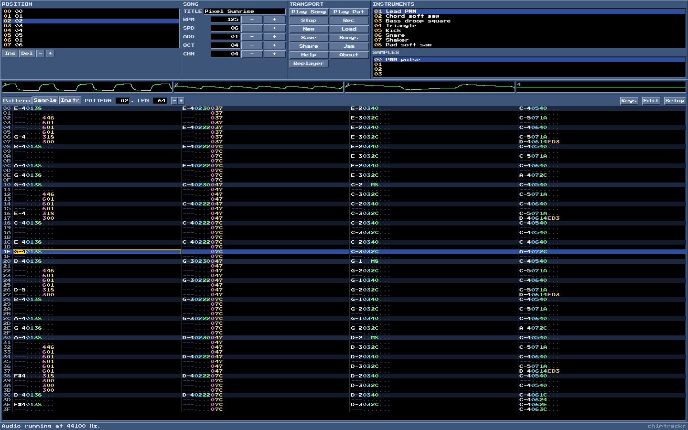
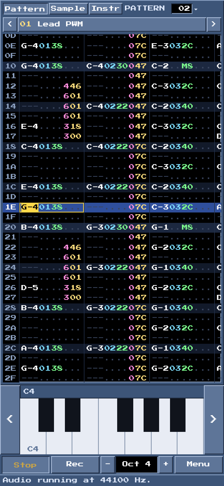

# chiptrackr

[](https://github.com/wirehack7/webtracker/actions/workflows/ci.yml) [](https://github.com/wirehack7/webtracker/actions/workflows/reference.yml) [Testing and coverage](docs/TESTING.md)

A chiptune tracker for the browser, made for the demoscene. Classic tracker interface, responsive on desktop, tablet and phone, with XM as its native format.

**Start it right in your browser: https://chiptrackr.com/**

<p>
  
  
</p>

The site can be installed as an app and then works offline as well. Songs are backed up in the browser as you work; the Save dialog brings back the latest versions and keeps a library of named songs. The library starts with a demo song, "Pixel Sunrise": four channels of generated chip sounds that try out most of the effects, instrument envelopes and auto-vibrato. Share puts the whole song, compressed, into a link that opens it again, with no server involved.

For your own demos and intros there is a [replayer](#replayer-for-demos-and-intros) that plays your songs with the same engine: [chiptrackr.com/replayer/](https://chiptrackr.com/replayer/). The Replayer button in the tracker opens that page, and Save > Open in replayer hands it the song you are working on.

Jam lets several people edit one song live. The host sends each person an invite link; they open it and send back an answer code, and from then on every edit travels straight between the browsers over WebRTC, with everyone's cursor shown in the pattern. Only a public STUN server (Google's) helps the browsers find each other's address; no song data passes through it. Some strict networks (certain mobile carriers, corporate firewalls) block such direct connections. "Open in a new tab" jams between tabs of one browser.

The interface, Help and the manual come in English, German and Finnish. Setup > Language picks one, or Auto follows the browser. Tracker terms such as Pattern, Sample, Instrument, Envelope and the effect names stay in English in every language, as trackers have always called them. More languages are welcome: [docs/TRANSLATING.md](docs/TRANSLATING.md) says how to add one.

## Inspiration

chiptrackr is heavily inspired by [MilkyTracker](https://milkytracker.org/) ([GitHub](https://github.com/milkytracker/MilkyTracker)), the open-source FastTracker II successor. We love MilkyTracker: its interface, its workflow and its sound are the benchmark this project measures itself against. If you want a native tracker on your desktop, go and use it.

## How this was built

chiptrackr is written with the help of an AI coding assistant, Anthropic's Claude. I decide what gets built and try out the results, and every change goes through a pull request with CI; commits written with the assistant carry a `Co-Authored-By: Claude` line, so the history shows which ones they are. Since generated code can look right and still be wrong, the replayer is checked against [libopenmpt](https://lib.openmpt.org/) in CI on every change to the engine or the file formats, and the test suite and browser smoke tests are described in [docs/TESTING.md](docs/TESTING.md).

No generative audio or image models were used. The sounds in the sample library and the demo song are produced by plain code in this repository, and the music you write in chiptrackr is entirely your own.

## Development

Requirements: Node 22 and pnpm 12 (`corepack enable` is enough).

```sh
pnpm install
pnpm dev        # dev server
pnpm test       # Vitest
pnpm typecheck  # TypeScript for all packages
pnpm build      # production build into packages/app/dist
```

How the project is tested, the measured code coverage, the replayer comparison with libopenmpt and what is not verified are written up in [docs/TESTING.md](docs/TESTING.md).

Render a module offline (same replayer as in the browser, output as WAV):

```sh
pnpm --filter @webtracker/formats render song.xm out.wav [seconds]
```

Robustness run over a folder of real modules (load and render 10 s each, no NaN):

```sh
MODULE_DIR=~/mods pnpm test
```

## Layout

| Package | Contents |
| --- | --- |
| `packages/engine` | Song model, replayer, mixer. No DOM dependency; runs in the AudioWorklet, in the export worker and under Node. |
| `packages/formats` | Loading MOD (ProTracker, xCHN, Soundtracker), XM 1.04, S3M (Scream Tracker 3), IT (Impulse Tracker, including compressed samples), MTM (MultiTracker), 669 (Composer 669, UNIS 669) and OKT (Oktalyzer), also packed in ZIP, gzip, MMCMP, PowerPacker or UMX, saving XM, MOD, XI and 8SVX samples, XP pattern and XT track files, sample import (WAV, AIFF, 8SVX, XI, Gravis PAT, raw PCM), WAV, FLAC and ZIP writers for export. |
| `packages/replayer` | The replayer for demos and intros: the engine in an AudioWorklet behind a small API, built into one JavaScript file. |
| `packages/app` | Vite app: UI, AudioWorklet and export worker in `src/audio/`, autosave in `src/storage/`, language packs in `src/i18n/`, service worker for offline use (written by `scripts/service-worker.mjs` after the build, with every file of the site, so the installed app runs fully offline). MP3 export uses [lamejs](https://github.com/zhuker/lamejs) (LGPL-3.0, an unmodified npm package), loaded as a separate file only when an MP3 is exported. Video export (`src/video/`) draws pattern and scopes on an OffscreenCanvas in a worker and encodes with WebCodecs; [Mediabunny](https://github.com/Vanilagy/mediabunny) (MPL-2.0, unmodified npm package) writes the MP4 or WebM file. Browsers without WebCodecs encoders record in real time with MediaRecorder instead. |

Every push to `main` is deployed to GitHub Pages. If the repository variable `TRACKING_CODE` is set (Settings > Secrets and variables > Actions > Variables), the deploy workflow puts its HTML in place of the `<!-- tracking-code -->` placeholder on every page; without it the pages ship with no tracking. The app itself only announces actions as a `chiptrackr:track` event on `window` (detail `{ name, data? }`, names such as `play`, `save-xm`, `export-audio`, `export-video`, `share-copy`, `jam-start`, `replayer-play`); the tracking code can listen for it and forward it to any analytics service.

## Replayer for demos and intros

The replayer plays songs in your own productions with the same engine as the tracker. It is one ES module with the AudioWorklet built in, so there is nothing else to host:

- [webtracker-replayer.js](https://chiptrackr.com/replayer/webtracker-replayer.js) plays every format the tracker loads (about 33 KB gzipped).
- [webtracker-replayer-lite.js](https://chiptrackr.com/replayer/webtracker-replayer-lite.js) plays XM and MOD only (about 21 KB gzipped).

A demo page is at [chiptrackr.com/replayer/](https://chiptrackr.com/replayer/). In the tracker, Save > Open in replayer opens it with the current song (passed in the address fragment, nothing is uploaded).

```js
import { createReplayer } from './webtracker-replayer.js';

// A URL, an ArrayBuffer or a Uint8Array. Options: context, destination, loop, volume, resampler, stereoSeparation.
const music = await createReplayer('song.xm', { loop: false });
music.onRow = ({ order, pattern, row, speed, tempo }) => {
  // Runs when the row is heard (output latency included), for syncing effects.
};
music.onEnd = () => nextScene();
startButton.onclick = () => music.play(); // browsers only start audio after a click or key press

function frame() {
  const t = music.time; // song time in seconds, as heard
  requestAnimationFrame(frame);
}
```

`pause()`, `stop()`, `seek(order, row)`, `volume`, `loop`, `position`, `isPlaying`, `song` (the loaded song, with its patterns for reading sync notes or effects) and `destroy()` complete the API. `loadSong(source, fileName)` parses a module without starting audio, so a page can show it before the first click and hand it to `createReplayer` later; pass `fileName` in the options when giving bytes, so tagless 15-sample MODs are recognised. For oscilloscopes, call `enableScopes()` and read `music.scopes` in a render loop: one `Float32Array` per channel with what it just played, in step with what is heard; `enableScopes(0)` turns them off again. The demo page uses this: click its view to switch between channel bars, the pattern and scopes. Build it with `pnpm --filter @webtracker/replayer build`; the files land in `packages/replayer/dist`.

## Usage

The keys follow the FT2 layout. The Help button in the app shows the full list. The essentials:

| Key | Action |
| --- | --- |
| Space | Stop, otherwise edit mode (Rec) on/off |
| Enter / Shift+Enter | Play song / pattern |
| Z–M, Q–U | Notes (by physical key), F1–F7 octave (also Numpad / and * or Ctrl+↑/↓), 1 or ` key-off |
| 0–9, A–F | Instrument, volume, effect and parameter in edit mode |
| Shift+arrows, mouse drag | Select a block; Ctrl+C/X/V copy, cut, paste |
| Alt+↑/↓ | Transpose (with Shift by an octave) |
| Ctrl+Z / Ctrl+Y | Undo / redo |
| Ctrl+S | Save as XM; the Save button also saves MOD, exports WAV, FLAC or MP3 (whole song or one file per channel) and renders a video of pattern and scopes (MP4 or WebM, wide, square or upright) |
| Click / right-click a scope | Mute / solo a channel |
| Ctrl+I | Interpolate the volume column or effect across the selection |
| Ctrl+E / Edit button | Transpose with instrument filter, remap instruments, scale volume (selection, track, pattern or whole song) |
| Stats button | Play time, XM and MOD file size, deflated size, size of every pattern, instrument and sample, what the song never plays; Optimize removes unused or duplicate patterns, unused instruments and samples, sample data after the loop, and can halve sample rates or round samples to 8 bits, with a before/after size preview and undo |
| Ctrl+Enter | Play the pattern from the cursor row (with Shift the song) |
| Alt+Enter | Play only the cursor row and step down, to go through a pattern row by row |
| F9–F12 | Jump to row 0, ¼, ½ and ¾ of the pattern |
| Shift+M / Shift+U | Mute the cursor channel / unmute all |
| Ctrl+F | Follow song on/off |
| Setup: Prospective view, Cursor wraps | Show the neighbouring patterns dimmed around the current one; stop the cursor at the first and last row |
| Alt+PageUp/PageDown | Previous/next song tab (new, loaded and shared songs open in tabs; Setup can turn this off) |
| Shift / Ctrl / Alt + F3–F5 | Cut, copy, paste the track / pattern / selection (Ctrl+F4 and Alt+F4 belong to the browser: copy the pattern with Ctrl+Shift+F4, the selection with Ctrl+C) |
| Alt+Q…I, Alt+A…K | Jump to channel 1–8 or 9–16 |

Besides cutting, normalizing, fades and resampling, the sample editor has tools to repair and shape samples: invert the phase, swap sign and byte order (for wrongly imported raw data), remove DC offset, reduce to 8 bits, low-pass and high-pass, loop crossfade, resample to any length, change the volume by any amount or as a ramp (Amp), draw the waveform by hand (Draw) and save as WAV or Amiga IFF 8SVX.

The built-in sample library (Library in the sample and instrument editors, or the instrument picker on phones) has chip waves, PWM loops, drums and effects to start a song with. Every sound in it is generated by code in `packages/engine/src/sample-library.ts`, so they are covered by the MIT license like the rest of the repository and free to use in any song.

Setup sets the sound: resampling (Auto plays MOD through the Amiga 500 filter, where E00/E01 switch the LED filter, and XM with linear interpolation; also Linear, Cubic, an 8-tap Sinc and no interpolation at all) the stereo width from mono to 200 % and the overall loudness (Amplify, 25–400 %). Audio export uses the same settings. Edit colours under Setup changes any colour of the scheme; the colours can be exported and imported as a file.

## License

chiptrackr is released under the [MIT License](LICENSE), copyright Markus Fritz (wirehack7). You may use, change and share it, also in your own demos, intros and commercial productions, as long as the copyright notice stays with it. The built replayer files carry a one-line notice for that.

The interface font Press Start 2P (SIL Open Font License 1.1), lamejs for MP3 export (LGPL-3.0) and Mediabunny for video export (MPL-2.0) come with their own licenses; see [THIRD_PARTY_NOTICES.md](THIRD_PARTY_NOTICES.md). Songs you make with chiptrackr are yours.
